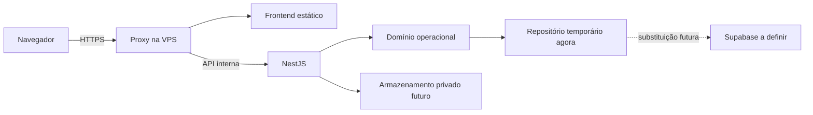

# Auditoria do Portal Interno Ápice

Data: 08/10/2026. Código de referência: commit `35e1d54`, versão `0.1.0`. Fonte: **PRD Portal Interno Apice.pdf**, versão 1.0 de 06/10/2026, 19 páginas e 52 seções. Projeto: `<pasta-do-projeto>`.

**Adendo de escopo:** após o levantamento, o usuário autorizou criar banco local migrável, usando PostgreSQL/Supabase como base, e ampliar massivamente os testes. Este documento preserva o diagnóstico do código de referência; implementações posteriores serão registradas em relatório de validação e no contexto, sem apagar os achados originais. A decisão de adiar o banco foi revogada pelo pedido posterior.

## 1. Parecer

**O projeto ainda não contém tudo que o PRD propõe, nem todo o P0/MVP.** Existe uma demonstração funcional de parte do ciclo mensal, com frontend React/Vite/TypeScript, backend NestJS, domínio compartilhado e testes. Ainda não é possível aceitar um fechamento real integral ou liberar dados reais.

O banco foi explicitamente adiado pelo usuário. Essa decisão explica a persistência temporária, mas não transforma os demais requisitos em itens entregues ou adiados por autorização. Login real, gestão de usuários, carteira por departamento, calendário, geração automática e tempo por etapa continuam pendentes.

O usuário definiu durante esta auditoria que **a aplicação ficará em uma VPS**. Essa é a referência de implantação daqui em diante. Não houve autorização para implantar agora nem definição de onde o Supabase futuro ficará. A versão atual depende de localhost e não funciona como aplicação de produção numa VPS sem adaptação.

Esta auditoria produziu documentação e reproduções. Não alterou regras de negócio, telas, autenticação ou banco para encobrir os achados.

## 2. Método e limites

- Leitura integral do PRD e confronto das 52 seções, dos itens P0 e dos 15 critérios de aceite com domínio, API, interface e documentação.
- Inspeção de permissões no servidor e domínio, sessões, upload/download, schemas, relatórios, geração e configuração de execução.
- Reexecução de tipagem, lint, 37 testes de domínio/API, build e quatro fluxos E2E nos dois adaptadores.
- Reproduções adicionais em instâncias isoladas, sem credenciais ou dados reais. Os E2E da API local acrescentaram somente fixtures fictícias ao ambiente demonstrativo.
- Inspeção da interface existente confirmou sidebar `rgb(22,175,196)` = `#16AFC4` e divergências do drill-down do dashboard.
- Consulta à Receita Federal para a mudança do CNPJ e à W3C para o requisito de contraste.

O acesso disponível foi ao código e ao ambiente local. Não há uma VPS fornecida para examinar firewall, TLS, sistema operacional, permissões de disco, backups, proxy ou exposição pública. Não é um pentest externo, certificação de acessibilidade ou parecer jurídico de conformidade LGPD. Ausência de vulnerabilidades no `npm audit` não comprova segurança integral.

Legenda: **presente na demo** = comportamento implementado e verificável no escopo temporário; **parcial** = somente parte do requisito; **ausente** = sem implementação; **futuro** = previsto nas fases posteriores; **decisão** = regra ainda precisa de definição. Não se atribui percentual de completude a seções de tamanhos e naturezas diferentes.

## 3. Cobertura integral do PRD

| Seção / página | Situação | Confronto com o projeto |
| --- | --- | --- |
| 1. Resumo executivo / 1 | Parcial | Prova parte de geração → execução → evidência → conferência → indicadores; não prova fechamento real sem ferramentas paralelas. |
| 2. Visão / 2 | Parcial | Idempotência mensal, prazos separados, bloqueios de conclusão e reabertura presentes; roteamento completo, fluxos versionados e publicação ausentes. |
| 3. Problema operacional / 2 | Parcial | Responde tarefas, responsável, datas, conferência e histórico; não explica vínculos/vigências completos, anexos rejeitados fiscais ou publicação. |
| 4. Posicionamento / 2–3 | Parcial | Domínio operacional separado do ERP; motor ainda limitado, com departamentos e etapas fixos. |
| 5. Solicitação × tarefa / 3 | Parcial | Task recorrente e avulsa existem; Request, vínculo externo e Process não existem. |
| 6. Ecossistema / 3 | Parcial/futuro | API própria e cliente desacoplado; nenhum contrato operacional com Portal do Cliente, billing ou mensagens. |
| 7. Modelo conceitual / 4 | Parcial | Company, TaskTemplate, Task, versões de documentos, usuários e audit; sem Client, Portfolio, regimes históricos, workflows e integrações. |
| 8. Multi-tenancy / 4 | Parcial | Filtros por tenant no domínio; somente tenant demo no login, sem cadastro, configuração por tenant ou unicidades de banco. |
| 9. Hierarquia / 4 | Parcial | Tenant → empresa → tarefa; falta cliente agregador, carteira e configuração completa de escopos. |
| 10. Personas / 4–5 | Parcial | Admin, coordenador, operador e consulta; sem diretoria, função de processos ou identidade de dispositivo TV. |
| 11. RBAC / 5 | Parcial | Autorização real dentro da demo; um papel global por pessoa, sem papel por departamento ou carteira configurável. Detalhes na seção 5 desta auditoria. |
| 12. Departamentos / 5 | Ausente como gestão | Fiscal, Contábil e Pessoal são uma union fixa; não há CRUD, responsáveis, regras ou visibilidade configurável. |
| 13. Clientes/empresas / 5 | Parcial | Cadastro/importação de empresa com nome, CNPJ, cidade, regime e um responsável. Sem cliente com vários CNPJs, CPF, inscrições, saída, edição ou inativação operacional. |
| 14. Regime e histórico / 5–6 | Ausente | Um campo `regime`; sem vigências, mudança por competência ou edição histórica. |
| 15. Carteira / 6 | Parcial | Um `ownerId` por empresa; redistribuição individual de tarefa. Sem responsável por departamento, lote ou desativação com tratamento de órfãs. |
| 16. Agrupadores/vínculos / 6 | Parcial | Modelo aplica a um regime ou Todos. Sem agrupadores, vínculo direto, exceções, vigência ou vinculação em lote. |
| 17. Modelo de tarefa / 6 | Parcial | Criação mensal, dias fixos, documento e conferência. Sem editar/inativar/versionar, outras periodicidades, calendário, P.O.P. oficial, regras de anexos/publicação/pastas. |
| 18. Geração / 6–7 | Parcial | Geração manual mensal idempotente em um processo; sem job, constraint persistente, saída/regime vigente e workflow completo. |
| 19. Periodicidades / 7 | Parcial | Mensal e avulsa manual. Sem bimestral, trimestral, semestral, anual ou intervalo de referência explícito. |
| 20. Prazos/calendário / 7 | Parcial | Meta e prazo legal distintos; nenhum feriado, dia útil, antecipação/prorrogação ou calendário de 12 meses validado. |
| 21. Estados/prazo / 7–8 | Presente na demo | Sete estados e situação de prazo derivada; relógio demonstrativo fixo. A espera não contabiliza/pausa tempo, pois não há cronômetro. |
| 22. Minhas tarefas / 8 | Parcial | Filtros, oito itens por página, urgência, painel lateral e ações. Paginação só no navegador; sem filtros salvos, lote seguro ou seleção livre de competências. |
| 23. Execução / 8 | Parcial | Checklist, arquivo aceito e conferência bloqueiam conclusão; histórico temporário e sem emissão de eventos de domínio. |
| 24. Workflow / 9 | Parcial | Sequência simples com conferência opcional; etapas genéricas fixas e número de versão. Sem cadastro/edição/versionamento do fluxo ou responsáveis por etapa. |
| 25. Conferência/dispensa/reabertura / 9 | Parcial | Segregação de participantes, solicitação e aprovação gerencial com motivo, primeira conclusão e contador preservados. Sem dispensa específica de anexo, tempo de retrabalho ou conferente configurável. |
| 26. Anexos / 9–10 | Parcial | Uma evidência lógica por tarefa, PDF/XML até 5 MB, conteúdo estrutural e hash na API. Sem múltiplos anexos exigidos ou política por modelo. |
| 27. Validação inteligente / 10 | Mínimo presente; avançada futura/decisão | Tipo/tamanho/estrutura verificados; não verifica CNPJ, competência, valores ou validade fiscal. A fase avançada está aberta no PRD. |
| 28. Versões documentais / 10 | Parcial | Nova versão sem sobrescrita, autor/data e bytes temporários; hash na API, não na prévia. Sem retenção durável e trilha completa de validação. |
| 29. StorageConnector / 10 | Ausente/futuro | Bytes em um Map de memória; sem contrato implementado de conector, pastas, destino por tenant ou armazenamento privado persistente. |
| 30. Avulsas / 11 | Parcial | Criação manual para uma empresa com duas etapas genéricas. Sem criação a partir de modelo, vários clientes, Request ou processo. |
| 31. Processos entre áreas / 11 | Ausente/futuro | Sem Process, blocos multidepartamentais, condição e roteamento por carteira da área. |
| 32. P.O.P. / 11 | Ausente/futuro | Roteiro ilustrativo identificado como demonstração; sem gestão ou vínculo versionado de procedimento oficial. |
| 33. Dashboards / 11–12 | Parcial | Panorama por departamento/competência e escopo. Sem visão própria de diretoria, tendências, hoje/semana, meta pessoal ou dispensas pendentes; CA15 incompleto. |
| 34. Relatórios / 12 | Parcial | Cinco visões essenciais com CSV e impressão; sem tempo, índice legal completo e taxa de retrabalho. Matriz tem perda de multiplicidade. Evoluções de 12 meses/salvos ausentes. |
| 35. TV / 12 | Ausente/futuro | Sem dispositivo, credencial própria, rodízio, privacidade e administração de TV. |
| 36. Auditoria / 12–13 | Parcial | Antes/depois de tarefas, motivo, autor/data. Memória mutável; sem eventos de login/download/permissão/IP/device e navegação integral do histórico. |
| 37. Tempo real/notificações / 13 | Parcial | Polling de snapshot a cada 5 s; feed de audit recente. Sem eventos, notificações destinatárias, prazo próximo, lidas/não lidas ou SLO definido. |
| 38. API compartilhada / 13 | Parcial | `/api/v1`, Swagger e entrada validada. Sem contratos completos de resposta/erro/paginação ou recursos de clientes, solicitações, carteiras, workflows, feriados, relatórios e webhooks. Nomes exemplificativos de endpoint não são exigência literal. |
| 39. Eventos/webhooks / 13–14 | Ausente/futuro | Audit em memória não é publicação de evento. Sem outbox, consumidor, entrega, retries, assinatura, idempotência ou webhooks. |
| 40. Contratos de dados / 14 | Ausente/futuro | Não implementa getDocuments/getBilling/getRequests/getPendingActions/getObligations para a interface externa. |
| 41. Portal do Cliente / 14–15 | Ausente/futuro | Sem publicação, faturamento, requests, mensagens, pendência ou resposta do cliente. |
| 42. Segurança/LGPD / 15 | Parcial | Controles locais descritos na seção 6. Identidade, HTTPS de implantação, políticas, armazenamento, audit durável e recuperação ainda pendentes. |
| 43. Entidades / 15 | Parcial | Tipos não representam integralmente o modelo proposto. Sem Tenant/Department configuráveis, Role/ProfileScope, Client, regime histórico, Portfolio, bindings, Workflow/Step completos, DocumentValidation, Request, BillingRecord, StorageConnector e SavedReport. |
| 44. Não funcionais / 16 | Parcial | Build/tipagem/testes, rotas lazy, foco e responsividade básicos. Sem carga concorrente, paginação API, índices, SLA/SLO, logs estruturados, métricas, backup/restauração e aceite WCAG completo. |
| 45. Design / 16 | Presente com limite de aceite | Paleta, Inter, densidade compacta, identidade textual e sidebar azul confirmados. Pedido posterior de priorizar azul prevalece sobre ação primária grafite do rascunho. WCAG AA integral não comprovado. |
| 46. MVP / 16–17 | Incompleto | Matriz P0 abaixo; não confundir aparência das telas com cobertura do requisito. |
| 47. Roadmap / 17 | Ainda sem passagem | Fase 0 incompleta; fase 1 parcial. Nenhum cadastro real validado ou fechamento mensal real concluído. Avulsa/espera simplificadas já existem apesar do roadmap posterior. |
| 48. Aceite / 17 | Parcial | Resultado individual CA01–CA15 abaixo. |
| 49. Métricas / 18 | Parcial | Volume, progresso e prazo da demo; sem adoção, operação fora do sistema, tempo, qualidade completa, carteira, integração e automação. |
| 50. Riscos / 18 | Mitigações parciais | Importação e regras de dispensa presentes. Permanecem riscos de prazo sem calendário, cobertura incompleta, escala, histórico temporário e publicação. |
| 51. Decisões / 18–19 | Parcialmente fechadas | Stack, banco temporário, paleta, sem logo e destino VPS definidos pelo usuário. Departamento/taxonomia, governança, conferente/fallback, auth/MFA, conector e eventos seguem pendentes. |
| 52. Governança / 19 | Decisão/processo | Contexto e Git registram decisões; não existe aceite operacional, ownership do núcleo formalizado ou processo acordado entre equipes. Não é funcionalidade que uma tela substitua. |

## 4. MVP e critérios de aceite

### P0 do PRD, sem retirar itens por conveniência

| Item P0 | Resultado da auditoria |
| --- | --- |
| Tenant/multiempresa/departamentos | Filtros no domínio; fundação configurável e persistente incompleta. Banco adiado; configuração de departamentos não depende de adiar banco. |
| Usuários/equipes/perfis | Cinco fixtures; sem cadastro, convite, identidade, equipes, inativação ou perfil por departamento. |
| Clientes/responsáveis por departamento | Empresas diretamente com um responsável; requisito incompleto. |
| Importação por planilha | CSV com prévia, até 200 linhas, duplicados preservados e lote atômico no processo. Escopo de campos limitado; não importa XLSX. |
| Regimes/agrupadores | Regime atual e filtro de modelos; histórico e agrupadores ausentes. |
| Modelos | Criar modelo mensal funciona; configuração operacional completa ausente. |
| Vinculação em lote | Ausente. |
| Geração automática | Ausente; somente acionamento manual. |
| Calendário/dias úteis | Ausente. Datas são exemplos. |
| Minhas tarefas | Base funcional; filtros salvos, lote e API paginada ausentes. |
| Anexo obrigatório | Bloqueio simples funciona; exigências múltiplas/configuráveis não existem. |
| Dashboard por perfil | Escopo filtrado; visões completas e drill-down incompletos. |
| Relatórios Excel/PDF | CSV e impressão com possibilidade de salvar PDF pelo navegador. Sem XLSX ou exportação PDF padronizada/validada. Aceite desse formato precisa ser explicitado. |
| Log imutável | Log temporário presente, imutabilidade/resiliência ausentes. |
| Tempo por etapa | Ausente. Não é consequência necessária de deixar o banco para depois. |

### CA01–CA15

| Critério | Parecer | Evidência / limite |
| --- | --- | --- |
| CA01 idempotência | Atendido na demo; parcial definitivo | Repetir geração mensal cria zero novas tarefas; busca por tenant/empresa/template/competência em `engine.ts:615`. Falta constraint/transação, por banco adiado. |
| CA02 vigência | Não atendido | Não há mudança de regime com vigência nem edição de fluxo. `templateVersion` sozinho não comprova esse critério. O teste de snapshots apenas gera duas vezes, sem mudar regime/fluxo (`engine.test.ts:267`). |
| CA03 prazo calculado | Atendido na demo | `deadline()` deriva meta/legal/conclusão; não há edição manual da situação. Calendário oficial continua ausente. |
| CA04 conclusão | Atendido para regra simples; parcial geral | `checkReady`, conferência e validação estrutural bloqueiam o ciclo. Não há várias evidências/políticas específicas por modelo. |
| CA05 conferência independente | Atendido na demo | Todos os participantes da execução do ciclo são impedidos de conferir, inclusive após redistribuição. Conferente autorizado ainda não é configurável. |
| CA06 dispensa | Atendido para tarefa; parcial anexo | Operador solicita; manager dispensa com motivo validado pela API. Sem dispensa individual de evidência. |
| CA07 reabertura | Parcial | Manager, motivo, primeira conclusão, audit e contador. Sem tempo de retrabalho e taxa calculada. Devoluções e reaberturas compartilham contador. |
| CA08 versões | Atendido na demo; parcial durável | Versões anteriores preservadas enquanto processo vive; bytes/hash da API. Reinício perde tudo. |
| CA09 auditoria | Parcial | Tarefas têm antes/depois/autor/data; cadastros/geração não têm todos os snapshots e falta audit de segurança e armazenamento imutável. |
| CA10 sem órfãs | Não comprovado | Não há desativação de usuário/carteira departamental. Fallback para primeiro manager é simplificação, não fila escalonada. Repro mostrou owner Consulta ainda elegível na geração. |
| CA11 isolamento tenant | Atendido nas regras testadas; parcial infraestrutura | Filtros e tentativas estrangeiras bloqueados na memória. API só oferece um tenant demo, sem Auth/RLS/persistência e sem validação em dois tenants reais. |
| CA12 API | Parcial/futuro | Frontend HTTP consome API. Nenhuma integração externa existente para validar o contrato completo; ausência de acesso a tabelas não prova aceite com consumidores externos. |
| CA13 publicação | Ausente/futuro | Portal do Cliente, flag de publicação e conector não implementados. |
| CA14 evento consistente | Ausente | Não há eventos publicados após persistência; audit não é event bus. |
| CA15 drill-down equivalente | Não atendido integralmente | Quatro cartões principais abrem listas, mas progresso/%/subcontadores não têm filtros próprios equivalentes; veja F03. |

## 5. Login, usuários e permissões: comportamento atual

### Login atual

Ao abrir o portal, o React escolhe **Júlia** automaticamente (`PortalContext.tsx:10`). Envia apenas um `userId` a `POST /api/v1/demo-session`, rota pública. São aceitos cinco IDs fixos, inclusive Helena/admin (`schemas.ts:87`). Não existe senha, e-mail confirmado, convite, SSO ou prova de identidade.

A API emite token aleatório de 32 bytes, válido por uma hora; guarda o ator na memória do servidor (`session.service.ts:11`). O cliente mantém o token em memória e envia Bearer. O guard resolve o ator no servidor, portanto cabeçalhos `X-Role` ou `X-Tenant-Id` não elevam permissões. Trocar perfil revoga a sessão anterior e cria outra. O endpoint DELETE revoga a sessão. Não há botão/fluxo corporativo completo de entrar/sair, gestão de sessões, renovação automática ou recuperação de conta. A expiração apresenta reconexão manual na interface.

**Token seguro não torna a seleção de perfil uma autenticação real.** Qualquer pessoa que alcance esse ambiente local pode selecionar o admin. Isso é deliberado na demo. `bootstrap.ts:14` e `session.controller.ts:34` recusam o modo fora de `development + DEMO_AUTH=true`, e `main.ts` escuta loopback. Remover essa proteção para publicar na VPS antes de substituir a identidade seria abrir acesso administrativo.

### Matriz efetivamente implementada

Todos os papéis ficam limitados ao tenant e aos departamentos presentes no ator para tarefas/modelos. O administrador demo inclui os três departamentos; um admin sem determinado departamento também é bloqueado naquele departamento.

| Ação | Admin | Coordenador | Operador | Consulta |
| --- | --- | --- | --- | --- |
| Ver tarefas | Departamentos do ator | Departamentos do ator | Próprias + conferências de terceiros elegíveis no departamento | Todas nos departamentos do ator |
| Executar/anexar/concluir | Tarefa no escopo | Tarefa no escopo | Apenas se responsável | Não |
| Conferir/devolver | Se não participou da execução | Mesma regra | Qualquer tarefa em conferência no departamento, se não participou | Não |
| Solicitar dispensa | Sim | Sim | Tarefa própria aberta, com motivo | Não |
| Aprovar dispensa/reabrir | Sim, com motivo | Sim, com motivo | Não | Não |
| Mudar responsável | Sim | Sim | Não | Não |
| Mudar prazo | Não existe a ação | Não existe a ação | Não | Não |
| Criar modelo/gerar manualmente | Sim | Sim no departamento | Não | Não |
| Cadastrar/importar empresa | Sim | Sim, sem governança configurável | Não | Não |
| Criar tarefa avulsa | Sim | Sim | Empresa da própria carteira, atribuição a si | Não |
| Baixar documentos/exportar | Dentro do snapshot permitido | Dentro do snapshot permitido | Inclui conferências acessíveis de terceiros | Dentro do snapshot permitido |
| Gerenciar usuários/departamentos/TV | Não implementado | Não implementado | Não | Não |

Evidências: `selectors.ts:18`, `engine.ts:82`, `engine.ts:137`, `engine.ts:157`, `engine.ts:230`, `engine.ts:297`, `engine.ts:332`, `engine.ts:406`, `engine.ts:445`, `engine.ts:468`.

### Divergências e decisões necessárias

- Um usuário tem **um papel global**, mais uma lista de departamentos (`types.ts:11`); não pode ser coordenador no Fiscal e operador no Contábil. Falta Role/ProfileScope por área/carteira, como exige o PRD.
- Diretoria, responsável por processos e dispositivo TV não têm representação.
- A conferência amplia automaticamente o acesso do operador a tarefas/evidências de outras carteiras. A segregação está correta, mas é preciso definir quem é conferente, como recebe a tarefa e o alcance desse acesso; não assumir que todo operador deve conferir tudo.
- Empresas retornam todas para coordinator/admin/viewer do tenant (`engine.ts:89`). Repro isolada mostrou coordenador Fiscal vendo metadados de empresa de operador só Contábil. Não é vazamento entre tenants; é ausência de política departamental de empresas/carteiras que o PRD deixa parcialmente aberta.
- Gestão de usuários e mudanças de permissão não existem. Não há convite, bloqueio, desligamento, transferência, substituto, aprovação de perfil nem revogação corporativa por alteração de acesso.
- Os indicadores do operador incluem tarefas de terceiros em conferência. A tela chama o conjunto de “Sua carteira”; indicadores próprios e fila de conferência devem ter população explicitada.

Para a versão real, o login deve comprovar identidade; o backend deve associar essa identidade a tenant e concessões vigentes, autorizar cada comando/download e registrar eventos de segurança. A tela esconder um botão é somente complemento à autorização do servidor. Planejar essa regra pode continuar com repositório temporário; conectar Supabase Auth/DB ficará sujeito às decisões seguintes.

## 6. Segurança e operação na VPS

### Controles presentes

Bearer opaco com expiração/revogação; guard global; filtros de tenant e departamento; viewer sem mutação; segregação de conferência; expectedRevision; schemas Zod estritos; motivos com 8–500 caracteres; Helmet; CORS/origin/host locais; JSON 64 KB, importação 256 KB; upload único 5 MB; limite global de bytes 32 MB; PDF estrutural e XML sem DTD/entidades/múltiplas raízes; SHA-256 na API; download com escopo e attachment; CSV com escape e neutralização de fórmulas; erros sem stack pública; sem chaves de banco no código operacional inspecionado.

### O que permanece pendente

Identidade real/MFA e gestão de usuários; escopos configuráveis; audit de login/download/permissão/IP; armazenamento privado e durável; sessão/revogação após alteração de acesso; retenção/descarte e política de backup/restauração; TLS real; gestão de segredos/certificados; proteção e monitoramento do ambiente; métricas/logs estruturados; validação dos controles com mais de um tenant persistente. Esta lista corresponde a requisitos de produto/infraestrutura e não comprova conformidade legal.

A validação estrutural aceita um XML simples `<qualquer/>`; isso é coerente com a camada mínima, mas não prova que a evidência corresponde à empresa/competência/obrigação. PDF estrutural não é varredura antimalware. Ao publicar e aceitar arquivos reais, definir a política de análise, rejeição/quarentena e liberação de download adequada aos documentos e ao fluxo.

### Impedimentos concretos para VPS

| Área | Estado atual | Direção para a VPS |
| --- | --- | --- |
| URL da API | `http://127.0.0.1:3001/api/v1` fixo no browser (`portal-client.ts:122`) | Usar configuração de ambiente ou `/api/v1` na mesma origem. Na VPS, localhost do navegador é o computador do usuário. |
| Inicialização | Produção recusada por depender de demo | Criar modo de produção depois de implementar identidade e requisitos de persistência; não apenas remover o bloqueio. |
| Rede | API loopback; frontend dev 5173 | API interna atrás de proxy HTTPS. Loopback pode ser preservado numa VPS única; não é necessário expor 3001 ao público. |
| Origin/Host | Só localhost/127 e origin 5173 | Configurar domínio confiável e tratamento de proxy. Auditar `trust proxy`/IP antes de confiar em cabeçalhos encaminhados. |
| Frontend | Vite dev e dist de duas modalidades | Servir `npm run build` como estático no proxy. `build:preview` é demo no browser e não é produto operacional com backend. |
| Cabeçalhos/CSP | Arquivo `_headers` da prévia | Nginx/Caddy não aplicam esse arquivo automaticamente; configurar cabeçalhos no servidor e validar CSP para os endpoints reais. |
| Processos | `scripts/dev.mjs` | Serviço supervisionado ou contêiner, reinício controlado, variáveis/secrets, health/readiness e rollback documentados. |
| Dados e arquivos | Maps na memória | Reinício/deploy perde estado e anexos. Banco segue adiado; operação real continua impedida enquanto não houver durabilidade adequada. |
| Escala | Sessões/rate limit/estado/bytes por processo | Não adicionar múltiplos workers/replicas com esse estado local; definir coordenação/persistência antes. |
| Armazenamento | 32 MB global, sem conector | Volume/bucket privado e política por tenant; futuro conector com conexão segura. Disco/backup separado dos artefatos de release. |
| Deploy | Sem pipeline/manifesto VPS | Definir build reproduzível, configuração, proxy/TLS, observabilidade e procedimentos; Git é local e não tem remoto. |

Arquitetura de referência a preparar, ainda não implementada:

O local de hospedagem do Supabase não foi inferido. Banco em serviço gerenciado e banco na própria VPS têm implicações diferentes e devem ser decididos quando o usuário retomar esse item.

## 7. Achados reproduzíveis e prioridades

Prioridade alta = impede aceite operacional ou produz informação incorreta relevante; média = comportamento incompleto/risco limitado que deve ser corrigido antes do piloto. Não se atribui criticidade de ataque público a uma demo limitada a loopback.

### F01 — Alta: cadastro rejeita CNPJ alfanumérico e aceita CNPJ inválido

`packages/domain/src/schemas.ts:43` usa regex exclusivamente numérica e não calcula dígitos verificadores. A reprodução aceita `00.000.000/0000-00` e rejeita o exemplo alfanumérico oficialmente publicado pela Receita. Afeta cadastro e importação. CPF também está previsto no PRD e não é suportado.

O PRD de outubro/2026 não explicita a mudança para CNPJ alfanumérico. A Receita informou a primeira emissão em 31/07/2026 e orientou os sistemas a aceitar/processar o novo formato; CNPJs anteriores permanecem válidos. Portanto essa lacuna já é relevante no cadastro atual. [Receita Federal: primeiro CNPJ alfanumérico](https://www.gov.br/receitafederal/pt-br/assuntos/noticias/2026/julho/receita-federal-gera-o-primeiro-cnpj-em-formato-alfanumerico).

Correção a preparar: identificador como string normalizada, aceitação dos formatos coexistentes, validação do dígito apropriada, CPF quando aplicável, testes compartilhados de UI/API/importação. Não consultar ou importar empresas reais automaticamente.

### F02 — Alta: matriz pode ocultar tarefas existentes

`ReportsPage.tsx:79`, `:110` e `:259` agrupam por **título** e pegam só o primeiro `.find(companyId + title)`. Duas tarefas avulsas com mesmo título na mesma empresa/competência são permitidas, assim como modelos distintos com títulos iguais. A reprodução criou duas tarefas e a lógica da matriz representou só uma; o CSV tem o mesmo defeito. Isso pode esconder pendência.

Correção a preparar: identidade do modelo/período e regra explícita para multiplicidade de avulsas; célula agregada com acesso a todas as tarefas, sem declarar que só existe a primeira. Não proibir avulsas legítimas apenas para contornar o relatório.

### F03 — Alta para CA15: indicadores não abrem a população equivalente

`OverviewPage.tsx:37` coloca `% na meta` dentro do cartão que abre **todas** as concluídas. `OverviewPage.tsx:55` põe “com meta vencida” no cartão que abre atraso **legal**. Progresso e dispensadas em `:158` não têm link próprio. Números por colaborador em `ReportsPage.tsx:323` são texto; apenas o nome abre todas as tarefas da pessoa. Barras de entrega abrem todas as tarefas da obrigação, sem separar numerador concluído e total.

A frase “Todos os indicadores abrem as tarefas que compõem o resultado” (`OverviewPage.tsx:272`) é mais ampla que o comportamento. DOM confirmou ausência de link no progresso. Correção: cada métrica deve carregar filtros e população iguais à fórmula, incluindo numerador/denominador de percentuais e período/departamento; adicionar teste que compare IDs e contagens.

### F04 — Média: rate limit de sessão contornável por variação do caminho

`bootstrap.ts:56` e `:60` distinguem login por comparação literal com `/api/v1/demo-session`. Express aceita barra final e rota com caixa diferente. Após atingir 30 sessões/minuto, a reprodução obteve 429 no caminho canônico e 201 em `/api/v1/demo-session/` e `/API/V1/DEMO-SESSION`; entram no limite geral de 300, embora a rota seja a mesma. Limite de 100 sessões segue presente.

Correção: classificar a rota normalizada ou aplicar limitação vinculada ao handler de login. Na VPS, revisar IP/proxy e limites por identidade/origem; várias pessoas do mesmo escritório podem compartilhar IP. Não ampliar limites apenas para fazer o teste passar.

### F05 — Média: código sequencial de empresa usa contagem de todos os tenants

`engine.ts:434` e `:567` usam `101 + state.companies.length`. Com 12 empresas Ápice e uma de outro tenant, o cadastro gerou `0114` em vez de `0113` na sequência do tenant. PRD §13 exige sequência por tenant. Não é leitura de registros estrangeiros, mas falta de independência da numeração. Corrigir em cadastro/importação e, no banco futuro, gerador/constraint por tenant.

### F06 — Média, prevenção de evolução: geração pode atribuir ao perfil Consulta

`engine.ts:627` resolve owner sem excluir `viewer`, embora cadastro e atribuição manual excluam. Fixture isolada com empresa cujo owner virou Consulta gerou três tarefas para esse perfil, que não pode executá-las. Não é caminho disponível hoje pela UI, pois não há edição/desativação de usuários; demonstra que CA10 não está preparado para alterações de acesso. Exigir usuário ativo/elegível, carteira da área e fallback/fila definidos.

### F07 — Média: histórico tem corte invisível de navegação

`SettingsPage.tsx:151` mostra somente os primeiros 100 eventos, sem paginação ou “carregar mais”, enquanto `:170` informa a quantidade total. Busca pode recuperar eventos específicos, mas não permite percorrer o restante do conjunto quando há mais de 100 correspondências. Para o volume do PRD, fornecer consulta paginada/filtros/exportação com escopo. A imutabilidade da persistência permanece outra lacuna independente.

### F08 — Lacuna obrigatória: audit de segurança não existe

Sessão, logout e download não chamam registro de audit (`session.controller.ts:41`, `:43`, `portal.service.ts:43`). Reprodução fez login/download/logout e acrescentou **zero** eventos. `X-Request-Id` não é um log estruturado. PRD §36/42 exige esses registros; falta IP/dispositivo e trilha de alteração de permissão, quando essa gestão existir.

### F09 — Limitação funcional: competências e relógio são fixos

`components.tsx:108` oferece agosto/setembro/outubro de 2026. API aceita outros meses, mas UI não permite consultá-los normalmente. `seed.ts:2` fixa referência em 07/10/2026. São escolhas de demo explicitadas, mas incompatíveis com operação contínua, prazo em tempo real ou fechamento nos meses seguintes.

### F10 — Limitação de segurança/escopo: carteira e conferente não são configuráveis

Os comportamentos reproduzidos na seção 5 precisam de decisão e implementação. Não foi comprovado vazamento cross-tenant no domínio testado. Também não foi comprovada autorização departamental completa de metadados de empresas; ela nem está representada no modelo atual.

### F11 — Limitação arquitetural: ausência de bytes vira PDF demonstrativo

`portal.service.ts:52` e `portal-client.ts:100` retornam `demoPdf()` quando não acham os bytes. Isso atende documentos iniciais fictícios; para armazenamento real, arquivo ausente deve ser erro observável, não um documento de exemplo apresentado como a evidência. Restringir fallback aos fixtures e manter integridade entre metadados, hash e conteúdo ao introduzir armazenamento.

### F12 — Limitação de produtividade/auditoria temporal

`types.ts:101` tem apenas id/título/completed por etapa, sem ator, início/fim ou duração. `startedAt` não fornece tempo ativo ou pausa. Relatório atribui entregas ao **assignee atual** (`ReportsPage.tsx:307`); redistribuir tarefa concluída pode mudar o total por pessoa. Conclusão original preserva data e histórico, mas não há campo imutável específico de executor/conferente original; essa atribuição depende de audit temporário.

Definir autoria e atribuição de indicadores, tempo por etapa/ciclo e espera antes de consolidar produtividade. Contador `reopenedCount` também aumenta na devolução (`engine.ts:264`), portanto separar eventos e tarefas retrabalhadas conforme a fórmula escolhida.

## 8. Qualidade, desempenho, interface e testes

### Qualidade e arquitetura

A separação `apps/web` / `apps/api` / `packages/domain`, o contrato PortalClient, schemas compartilhados, rotas lazy e expectedRevision são bases úteis. A UI não é a única camada de autorização. O banco não está acoplado a componentes de tela.

O repositório, porém, lê/clona e substitui o estado completo de forma síncrona (`types.ts:172`). Migrar para Supabase não será apenas trocar uma classe: serão necessárias operações assíncronas, consultas paginadas, transações, atualização condicional da revisão, constraints e audit consistente. O engine central concentra casos de uso; separar capacidades de usuários/carteiras/calendário/documentos à medida que forem implementadas sem duplicar regras no frontend.

Audit usa textos de ação e o relatório os seleciona por regex. Adotar identificadores estáveis de evento ao implementar integrações evita depender de traduções para a regra de negócio. Não há pipeline CI, release VPS, coleta de cobertura, teste de restauração ou observabilidade estruturada. Lockfile e comandos de validação existem; Git está local e sem remoto/backup remoto confirmado.

### Desempenho

A lista pagina oito tarefas **depois** de receber o snapshot inteiro. A API não oferece consulta paginada nem filtro de competência. Polling repete esse conjunto a cada 5 segundos; históricos/documentos/audit crescem juntos. Algumas consultas percorrem listas repetidamente com `.find`/`.some`; relatórios renderizam todas as linhas.

Repro isolada com 4.000 tarefas fictícias: snapshot JSON **3.496.468 bytes (~3,5 MB)**; média de **32,98 ms** em cinco chamadas apenas ao domínio. Isso não inclui rede, serialização HTTP, browser, concorrência nem histórico anual. Um cliente em foco pode transferir cerca de 42 MB/min só de JSON desse tamanho no polling, antes de compressão/cache. Não é reprovação de SLA por esse microteste; é evidência de que a paginação visual não resolve o requisito de escala.

Para o piloto e a VPS, definir população por consulta, paginação/ordenadores/filtros no servidor, atualização incremental/eventos e limites mensuráveis; testar 500 empresas, 4.000 tarefas/mês, histórico, usuários concorrentes e exportações. Índices ficam para o banco futuro. SLO/SLA ainda precisam de definição no PRD.

### Interface e acessibilidade

Sidebar Ápice azul, identidade textual, Inter e paleta restrita confirmados. Favicon é um ícone genérico de lista, não logomarca. Modais Radix, rótulos, skip link com foco programático e foco visível são presentes; o skip link intercepta o clique e não troca a rota. E2E de 390 px verifica ausência de overflow externo e largura do drawer. Desktop foi inspecionado.

Essas verificações não comprovam WCAG AA integral. Validar contraste computado em todos os estados, teclado dos fluxos, zoom/reflow, leitor de tela, mensagens de erro/foco e navegação móvel. O teal claro não deve virar texto pequeno sobre branco; contraste mínimo AA para texto comum é 4,5:1 e texto grande 3:1, conforme [W3C: contraste mínimo](https://www.w3.org/WAI/WCAG22/Understanding/contrast-minimum.html). Preserve a paleta ao corrigir contrastes, usando grafite/teal profundo e variações permitidas.

Telas “Empresas e carteira” e “Configurações” sugerem amplitude maior que os cadastros reais: empresas só têm owner único e configurações só consultam fixtures. Textos de “memória da sessão” devem esclarecer que na API bytes/estado são globais ao processo e compartilhados pelas sessões autorizadas, não um armazenamento privado por pessoa.

### Verificações executadas nesta auditoria

| Verificação | Resultado |
| --- | --- |
| `npm run check` | Passou: TypeScript, lint, 37 testes (24 domínio + 13 HTTP), builds domínio/API/web. |
| `npm run test:e2e` | Quatro fluxos passaram na API local. |
| `npm run test:preview` | Os mesmos quatro fluxos passaram no adaptador do navegador. Não são oito cenários independentes. |
| `npm audit --json` | Zero vulnerabilidades conhecidas na consulta de 08/10/2026. |
| Repro segurança | Produção recusada; 401 sem sessão; seleção demo admin; zero audit de login/download/logout; bypass de classificação do rate limit; escopos/segregação confirmados. |
| Repro funcional | Matriz colapsa duas avulsas; numeração global entre tenants; owner Consulta na geração; CNPJ numérico inválido aceito/alfanumérico rejeitado. |
| Microteste volume | 4.000 tarefas; ~3,5 MB por snapshot. Sem aceite de concorrência/SLO. |

Os testes não cobrem os módulos ausentes. Ainda faltam, entre outros, cenários de calendário de 12 meses, vigência real, desligamento/órfãs, papéis por departamento, métricas com filtros equivalentes, identidades de dois tenants persistentes, segurança dos bytes reais, carga, recuperação e implantação na VPS. O teste que menciona preservação de workflow não altera um workflow e não pode ser usado para declarar CA02 aprovado.

## 9. Lacunas e ambiguidades do próprio PRD

Não são novas funcionalidades autorizadas. São pontos a fechar na especificação e exemplos para teste/aceite.

1. **Chave de recorrência:** RN01 fala modelo + cliente + período (§18), CA01 fala modelo + empresa + período (§48). Definir empresa executora e cliente agrupador; incluir tenant e intervalo normalizado, especialmente fora do mensal.
2. **Vínculos concorrentes:** falta precedência de vínculo direto, regime, agrupador, exclusão e exceção; duplicidade e aplicabilidade são problemas diferentes. Definir vigência.
3. **Entrada/saída/regime:** atendimento no meio do período, retroativo, antecipação de geração e mudança em trimestre/ano não têm regra fechada. “Futuro” deve distinguir ainda não gerado de tarefa antecipada já instanciada.
4. **Fases inconsistentes:** tempo por etapa é P0, mas relatório de tempo/espera aparece em 1B; P.O.P. é prometido no drawer e também fase posterior; avulsa aparece fase 2, embora o núcleo a trate; conferência/dispensa/reabertura não são listadas claramente em P0, mas integram aceite. CA13 exige ponte externa descrita na fase 3. Criar matriz única requisito × fase × aceite.
5. **Conferente e permissões:** quem pode conferir, quem atribui, acesso fora da carteira, substituições e perfis simultâneos estão indefinidos. Especificar Diretoria, Consulta e responsável de processos sem recorrer a admin para todo caso.
6. **Estados e cronômetro:** definir todas as transições/atores/pré-condições; retorno após devolução/espera, reversão de dispensa, reabertura e necessidade de evidência nova. Tempo ativo, corrido ou útil? Permitir simultaneidade? Como pausar/noite/férias e medir retrabalho?
7. **Dispensa de anexo:** aparece no §25, mas falta modelo de solicitação/aprovação separado da dispensa da tarefa. Esclarecer se manager pode dispensar diretamente e como negar/cancelar solicitação.
8. **Prazos/calendário:** definir fuso, corte do dia, UF/município por empresa, regra de fins de semana, feriados conflitantes e correções após geração. Distinguir conclusão após meta e antes do legal; essa distinção já aparece corretamente no código.
9. **Métricas:** definir população/período, denominador zero, primeira/última conclusão após reabertura, dispensas no risco legal, contagem de eventos versus tarefas no retrabalho e autoria após redistribuição. Cada número deve abrir a mesma população.
10. **Evidência válida:** especificar última versão ou última válida, versões rejeitadas/pendentes, conclusão/publicação, duplicação de upload, falha de armazenamento e exigência de nova versão no retrabalho. Validação avançada continua decisão de escopo, não aceite presumido.
11. **Cadastro de identificação:** adicionar coexistência de CNPJ numérico/alfanumérico, CPF, normalização/dígito verificador e regras de duplicidade. O PRD não registra a mudança cadastral vigente citada em F01.
12. **Processos:** definir entidade/instância Process e relação com tarefas/etapas de vários departamentos. A lista de entidades não a explicita suficientemente.
13. **Eventos/integrações:** definir evento identificável, idempotência, outbox/consistência, retries, assinatura/segredos, falhas/alertas, schema/versionamento e relação Request→uma/várias tarefas. Reentrega não pode criar execução duplicada.
14. **Login/ciclo do usuário:** fechar autenticação única, convite/aprovação, tenant de ingresso, desligamento, expiração/renovação/revogação, MFA de privilegiados e dispositivos. Definir fallback/escalonamento quando não houver executor ou conferente elegível.
15. **Critérios mensuráveis:** SLA/SLO, latência, atualização, carga, RPO/RTO, retenção/descarte, restauração e evidências de acessibilidade ainda não são parâmetros verificáveis. Não inventar valores para declarar aceite.
16. **VPS:** acrescentar decisão técnica de implantação, domínio/proxy/TLS, configuração por ambiente, processos, disco/bucket privado, monitoramento, build/rollback e backup. Stack já foi escolhida; formalizar ADR separado sem reabrir a decisão gratuitamente.
17. **Governança:** confirmar piloto Fiscal/taxonomia, owner do núcleo/API, quem valida calendários/modelos e quem aceita a passagem de fase. Testes técnicos não substituem esse aceite operacional.

## 10. Sequência recomendada a partir desta auditoria

1. Corrigir achados existentes: CNPJ, matriz, drill-down, classificação de rate limit, sequência por tenant, navegação do audit e elegibilidade de owner. Acrescentar regressões que reproduzam os defeitos.
2. Fechar as regras de fase/P0, carteira por departamento, conferente, ciclo de acesso, prazo/calendário, cronômetro e métricas. Registrar exemplos de aceite com o responsável da área.
3. Completar a fundação ainda com adaptadores temporários onde apropriado: usuários/perfis/escopos, departamentos, clientes/empresas, regimes/vigências, carteira, vínculos e workflows. Planejar contratos de identidade/persistência/armazenamento para evitar uma troca superficial.
4. Completar operação recorrente: calendário validado, periodicidades do escopo aceito, geração agendada idempotente, tempo por etapa/espera, audit e relatórios completos.
5. Preparar configuração e operação na VPS: frontend estático, API interna, proxy/HTTPS, ambiente, logs/métricas, supervisão, limites e procedimentos de release. Não publicar a seleção de admin da demo como login real.
6. Quando autorizado retomar banco/serviços definitivos: persistência transacional, Auth e políticas de escopo/RLS, armazenamento privado, audit durável, constraints, backup/restauração e testes de isolamento/concorrência. Decidir hospedagem do Supabase nesse momento.
7. Validar um ciclo mensal piloto com todos os casos de aceite. Somente depois aceitar passagem de fase e habilitar operação real. TV, processos avançados, integrações/Portal do Cliente e IA seguem o roadmap aprovado.

Nenhuma implantação, mudança de audiência, provisionamento da VPS ou banco foi realizada nesta auditoria.
