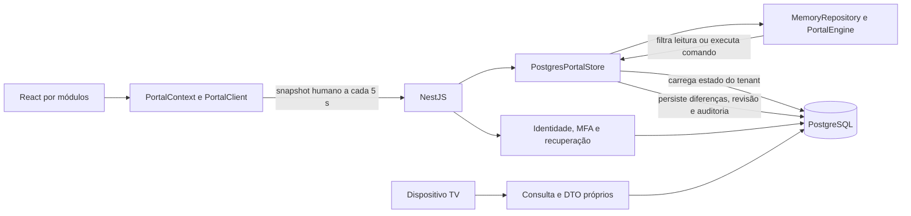
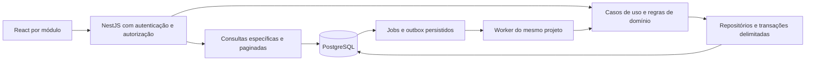

# Parecer de arquitetura e escalabilidade

Data: 17/10/2026. Autor: Codex, com revisão independente por um segundo agente Codex somente em leitura. Base funcional: commit `53a6c43` e resultados da bateria massiva de 17/10/2026.

**Estado: proposta técnica para avaliação do Claude. Nenhuma das refatorações abaixo foi implementada nesta etapa.** Este parecer registra a análise solicitada pelo usuário; não autoriza publicação, troca de infraestrutura ou reescrita do produto. O destino continua sendo uma VPS.

## Recomendação principal

Manter React + Vite + TypeScript, NestJS e PostgreSQL e evoluir para um **monólito modular**, com consultas específicas e comandos por módulo. Primeiro reduzir quanto cada operação lê e processa; depois separar trabalho pesado em um worker. A arquitetura atual tem boas proteções de integridade, mas seu caminho operacional ainda trata o escritório inteiro como uma unidade de trabalho.

O primeiro investimento recomendado é **lista e resumo de tarefas consultados diretamente no PostgreSQL, com autorização, filtros e paginação no servidor**. É uma melhoria delimitada, verificável e que pode ser introduzida preservando os comandos atuais. Aumentar a VPS não elimina o custo crescente de carregar todo o histórico em cada requisição.

## O que já merece ser preservado

- Separação entre interface, transporte HTTP, domínio e persistência; regras e contratos TypeScript compartilhados; adaptador em memória útil para testes e demonstração.
- Migrações versionadas com checksum, PostgreSQL portável e ausência de acesso privilegiado ao banco pelo navegador.
- RLS por tenant, ator revalidado no servidor, grants persistidos, departamentos e escopo pessoal/equipe; cargo não é teto de permissão.
- Revisões otimistas, constraints de unicidade, evidências com hash/versão e auditoria na transação da alteração. O banco persiste diferenças; **não regrava todas as linhas a cada comando**.
- Regras compartilhadas de data em São Paulo, versões documentais vigentes, conferência independente e cancelamento separado de dispensa.
- Feed de TV com identidade e DTO próprios. Ele já busca tarefas por competência/departamento em SQL; nem toda consulta do projeto usa o snapshot humano integral.
- Testes de concorrência, isolamento, recuperação e portabilidade. Eles são uma referência de comportamento durante uma migração, sem representar prontidão de produção.

## Arquitetura observada

O monorepo organiza pastas, mas o backend ainda concentra controllers/fábricas no `AppModule`, e o `PortalEngine` reúne execução, empresas, modelos, processos, propostas e importações. O contrato `PortalStore.run(callback do PortalEngine)` também vincula a persistência ao motor de estado integral. A separação física em pastas ainda pode evoluir para limites explícitos de dependência.

### Evidência de carga disponível

Fonte: `scripts/test-database.mjs:823–868`, relatório privado `.local/verification/massive-latest.json` e [registro dos testes](TESTES-MASSIVOS-2026-10-17.md). Não foi executada nova carga para produzir este parecer.

| Observação | Resultado da execução local |
| --- | --- |
| Massa | 500 empresas × 8 modelos = 4.000 tarefas |
| Geração disputada | 12 chamadas; sem duplicação |
| JSON serializado de um snapshot | 3.381.491 bytes, aproximadamente 3,4 MB, antes de compressão |
| Leitores simultâneos do store | 40 |
| Latência de `store.snapshot`, p50 / p95 | 2.073 ms / 3.524 ms |
| Disputa da mesma revisão | 80 comandos; um sucesso e 79 conflitos |

Os tempos medem chamadas diretas ao store nesta máquina, incluindo espera pelo pool e processamento do adaptador. Não incluem transporte HTTP, renderização, latência de internet ou a futura VPS. O campo `generationBatchMs=3.567` inclui as 12 gerações **e a consulta inicial de conferência**, conforme a posição do cronômetro no script; não é tempo isolado do SQL de geração.

Isso comprova integridade nesses cenários e oferece um indício concreto de custo nas leituras. Não identifica quanto do p95 vem de SQL, fila do pool, cópias, filtros ou serialização. Essa decomposição precisa de instrumentação. Também não houve medição sustentada por horas, crescimento plurianual ou benchmark de capacidade da VPS.

## Melhorias em ordem de prioridade

Prioridade indica sequência técnica; esforço é relativo, não estimativa de prazo. Nenhuma linha significa implementação concluída.

| Prioridade | Evidência atual | Risco ao crescer | Evolução proposta | Esforço |
| --- | --- | --- | --- | --- |
| 1 | `postgres-store.ts:34–72,253–320` lê todas as coleções do tenant, incluindo auditoria inteira e metadados de anexos | Custo de uma lista cresce com todo o histórico do escritório | Consultas por módulo, DTOs mínimos, filtros/agregações SQL e paginação real | Médio |
| 1 | `PortalContext.tsx:35–39,81–82` consulta snapshot a cada 5 s e invalida a consulta inteira após mutação | Trabalho repetido em telas que precisam de poucos dados; invalidação ampla | Separar identidade/configuração, lista, detalhe e indicadores; invalidar recursos afetados | Médio |
| 2 | `postgres-store.ts:275–279,330–407` usa lock por tenant, inclusive em download auditado | Operações independentes aguardam a mesma fila de escrita | Casos de uso com leituras e alterações delimitadas; locks menores e transações curtas | Alto |
| 2 | `app.module.ts` e `PortalStore.run`; `engine.ts` concentra diversos domínios | Mudanças de um módulo atingem outros; persistência difícil de especializar | Módulos NestJS, portas de consulta e casos de uso explícitos | Médio/alto, incremental |
| Antes de várias réplicas | `session.service.ts:30–41`; `bootstrap.ts:53–94` | Sessões/rate limits divergem entre processos; reinício derruba sessões | Sessão opaca compartilhada e política de limites apropriada ao proxy/múltiplos processos | Médio |
| Antes de automações volumosas | Geração/importação síncronas; envios de recuperação usam promessas em memória | Requisição longa, trabalho interrompido em crash e repetição de efeitos | Worker, jobs duráveis, idempotência e outbox transacional | Médio/alto |
| Desde a primeira evolução | Há request ID, readiness e hooks, sem medição detalhada das fases no caminho revisado | Aumentar recursos sem conhecer o gargalo | Métricas por rota/use case, SQL, pool, locks, memória e jobs | Médio |
| Conforme volume de arquivos | `documents.content` em bytea; leitura de quota agrega bytes por tenant | Crescimento de backup, memória do upload/download e custo da quota | Interface de armazenamento privado; manter bytea inicialmente e migrar bytes quando medido | Médio |
| Antes de regras fiscais reais | Periodicidade mensal, dias 1–28 e três regimes fixos | Crescimento de exceções e alterações que reescrevem indevidamente o passado | Calendário e regras com vigência, versão, elegibilidade e simulação de impacto | Alto, requer validação de negócio |

### 1. Consultas pequenas e autorização equivalente

Separar o que a página precisa: sessão/permissões, configuração organizacional, lista de tarefas, detalhe da tarefa e indicadores. O detalhe carrega comentários, etapas, histórico e documentos quando aberto. A auditoria geral deve ter consulta própria e paginada. **Os bytes de todos os anexos não são carregados pelo snapshot atual**; o custo identificado é de payloads e metadados.

Filtrar tenant, departamentos, visibilidade pessoal/equipe/fila, competência, situação e busca antes de `LIMIT`. Sem `tasks.team.view`, a consulta atual permite tarefas próprias e a fila do departamento autorizado; preservar essa exceção à regra pessoal. Autorizar agregações e contagens pelo mesmo recorte da lista. RLS atual isola tenants, mas não substitui as regras de grants, departamentos ou dados individuais. Proibir totais globais seguidos de filtragem apenas no frontend.

Usar ordenação estável com desempate por ID e cursor para listagens profundas. A documentação do [PostgreSQL sobre paginação](https://www.postgresql.org/docs/current/queries-limit.html) explica a necessidade de ordem previsível e o custo de grandes offsets. Cursor não congela dados mutáveis: ao mudar filtros, ordenação ou revisão do recorte, reiniciar a navegação; exportações que exigirem consistência devem usar um recorte consistente próprio.

Reutilizar os índices existentes `tasks_scope`, `tasks_owner` e `audit_order` como ponto de partida. Adicionar/ajustar índices somente após consultar planos e buffers em massa representativa, usando [EXPLAIN](https://www.postgresql.org/docs/current/using-explain.html). Uma consulta de contadores pode legitimamente percorrer muitas linhas; a exigência é não levar todo o estado para o Node/browser.

Relatórios hoje são montados em JavaScript sobre `engine.snapshot(actor)`. A paginação de 25 linhas em `ReportResultView.tsx:55–60` é visual: o resultado completo já chegou. Evoluir builders por família para consultas autorizadas, agregações e exportação do recorte inteiro sem depender da página exibida. Preservar os 31 relatórios e seus filtros; não trocar tudo na primeira entrega.

No React Query, usar chaves por tenant, pessoa, versão de autorização, módulo e filtros. Na revogação ou troca de grupo, limpar dados incompatíveis. A princípio, polling pode continuar nas consultas menores. Depois avaliar notificação por SSE com eventos mínimos de invalidação; cada nova consulta continua autorizada. Não transportar snapshot de pessoas pelo canal público da TV.

### 2. Transações e concorrência por operação

O lock atual é transacional e oferece serialização simples. PostgreSQL libera esse lock ao terminar a transação, conforme a [documentação de locks](https://www.postgresql.org/docs/current/explicit-locking.html). O problema para escala é sua abrangência e o trabalho feito enquanto está retido, não a existência do mecanismo.

Identidade, MFA e recuperação usam a mesma chave de tenant do store operacional. Pelo código, uma operação longa pode atrasar essas escritas; **essa latência específica ainda não foi medida**. Não remover ou mudar chaves de locks isoladamente: operações que compartilham invariantes precisam continuar coordenadas durante a migração.

Evoluir um caso de uso por vez: carregar ator atual e os registros necessários, validar, aplicar CAS/locks de linha ou de agregado, persistir estado e auditoria juntos. Comandos diferentes em tarefas independentes devem poder avançar sem carregar o escritório inteiro. Na geração e nas propostas, preservar validação da versão da empresa/modelo, unicidade e idempotência. CAS de uma tarefa sozinho não protege regras que abrangem empresa, modelo ou processo.

Fixar ordem de aquisição de locks para operações em lote e testar conflitos/deadlocks. Revalidar autorização dentro da transação que grava. Download deve consultar somente a tarefa/documento autorizados e registrar o acesso sem carregar todo o histórico; definir precisamente a garantia do registro de auditoria antes de alterar esse fluxo.

### 3. Módulos e dependências

Organização sugerida, ainda no mesmo backend e banco:

| Módulo | Responsabilidade e limite |
| --- | --- |
| Identidade e acesso | Login, MFA, recuperação, sessões, contas, concessões e políticas |
| Organização | Grupos/tenants, departamentos, cargos e vínculos |
| Empresas e carteira | Cadastros, responsáveis, situação, histórico e propostas de alteração |
| Modelos e calendário | Versões de obrigação, elegibilidade, periodicidade e cálculo de prazo |
| Processos | Fluxos entre setores, implantação e dependências |
| Execução de tarefas | Estado, checklist, fila, comentários, conferência e encerramento |
| Documentos | Metadados, versões, regras, integridade e armazenamento |
| Consultas e relatórios | Projeções autorizadas e exportações, sem alterar a operação |
| TV | Dispositivo, pareamento, revogação e feed sanitizado |
| Jobs e integrações | Agendamento, outbox, tentativas e efeitos externos |

O `AppModule` passa a compor módulos; controllers chamam casos de uso explícitos. Domínio não depende de NestJS, React ou SQL. Repositórios não recebem callbacks de um motor global. Evitar um repositório genérico que dê a todos os módulos acesso a todas as tabelas.

Separar exports de contratos/validação e seletores usados no browser das implementações de motor, fixtures e validação pesada de arquivos. Hoje `portal-client.ts:1–25,161–165,717–719` contém clientes HTTP e demo e importa motor/fixtures no mesmo arquivo. Isolar o demo em entrada própria permite verificar que o build operacional não carrega esse caminho. Não atribuir um tamanho exato de bundle a uma biblioteca sem analisar o build; este parecer não realizou essa análise.

A política continua única e testável. Consultas SQL e seletores de apresentação terão implementações diferentes, mas devem ter testes de equivalência do escopo e dos indicadores. Evitar novas regras de negócio escondidas em componentes de tela.

Estrutura alvo proposta, no mesmo repositório e inicialmente na mesma VPS:

O worker é introduzido quando houver a necessidade descrita abaixo. Eventos/jobs complementam o estado operacional persistido; a proposta não adota event sourcing nem múltiplos bancos.

### 4. Identidade, grupos e orçamento da VPS

O limite atual é de **100 sessões emitidas por processo, somando tenants**; não significa 100 usuários cadastrados ou capacidade validada para 100 pessoas. Sessões ficam em `Map`, expiram em uma hora e somem no reinício. Antes de múltiplas instâncias, sugerir sessões opacas com hash persistido, expiração e revogação em PostgreSQL; Redis é alternativa a avaliar com a carga. Definir limites por conta/tenant e limpeza de sessões, preservando controles contra abuso. JWT não é requisito para escalar.

Grants, conta ativa, troca de senha e versão de credencial devem continuar sendo revalidados. Cache futuro deve considerar versão da autorização e revogação. O rate limit por IP atual também precisa considerar que vários funcionários podem compartilhar o mesmo IP e que um proxy altera o IP observado. Configurar proxies confiáveis explicitamente e combinar critérios por IP/conta sem expor existência de usuário.

Os pools configurados somam **até 24 conexões por processo**: operação 12, identidade 4, MFA 4 e recuperação 4; a TV usa o pool operacional. Isso é limite configurado, não 24 conexões permanentemente abertas. Réplicas e workers multiplicam o teto. Centralizar configuração e orçamento, reservando capacidade para administração, migrações e backup; pools separados podem preservar capacidade para identidade. O guia oficial do [node-postgres](https://node-postgres.com/guides/pool-sizing) orienta considerar todas as instâncias no dimensionamento. Não aumentar cada pool automaticamente.

Contábil, Go e Condomínios têm seleção visual e demonstrações isoladas. Autenticação normal dos demais grupos ainda não é uma implantação concluída. Definir relação grupo/tenant e associação do usuário no servidor; o grupo informado pelo navegador não deve conceder acesso.

### 5. Jobs, arquivos e operação

Começar com worker do mesmo repositório e jobs persistidos no PostgreSQL é uma opção de menor infraestrutura para avaliar. O desenho deve ter chave idempotente, estado, agendamento, tentativas limitadas, prazo, lease/recuperação após crash e status consultável. `FOR UPDATE SKIP LOCKED` pode distribuir jobs entre consumidores; o [PostgreSQL](https://www.postgresql.org/docs/current/sql-select.html) o indica para filas, não para consultas normais que exigem visão completa. Outra opção é BullMQ, cuja integração [NestJS](https://docs.nestjs.com/techniques/queues) exige Redis. Não adicionar os dois motores juntos.

Guardar a intenção de um efeito externo na mesma transação do comando (outbox) e entregá-la depois. Consumidores precisam tolerar reentrega; não prometer exatamente uma entrega SMTP. A caixa local `MAIL_OUTBOX_DIR` é recurso de desenvolvimento, não essa outbox operacional. Códigos MFA/reset têm prazo curto: definir TTL, cancelamento de envios superados, tratamento seguro do segredo e evitar reenvio automático de código vencido. A autorização de quem solicita e de quem baixa um resultado também deve ser revalidada.

Bytea pode permanecer no início. Se arquivos dominarem banco/backup, introduzir `DocumentStorage` com backend privado de objetos. Banco mantém IDs, hash, tamanho, versão e vínculo com tarefa. Migração precisa de conferência por hash, leitura compatível temporária e tratamento de upload órfão; armazenamento externo não compartilha transação SQL. Manter download autorizado, expiração curta de eventual URL assinada e política para retenção/backup dos bytes. Não tornar anexos públicos.

Na VPS, separar proxy HTTPS/arquivos estáticos, API e PostgreSQL em processos com limites e persistência apropriados; worker quando necessário. A configuração atual **recusa produção** em `bootstrap.ts:24–29`, restringe origem a localhost e escuta loopback. Produção exige configuração explícita, não apenas remover a trava: origem/domínio, proxy confiável, cookies/headers, segredos, papel de banco, SMTP, logs e desligamento de atalhos/simulações. Hooks de encerramento e fechamento dos pools já existem; preservar e testar o caminho na VPS.

Readiness/liveness, request ID correlacionado e erros internos observáveis sem segredos; métricas de duração/erros, espera do pool, locks, bytes, CPU, memória, event loop, idade/tentativas dos jobs e espaço em disco. Usar labels de baixa cardinalidade, sem CPF/CNPJ, tokens ou nomes pessoais. Definir com o negócio RPO/RTO e testar restauração em destino separado com backup fora da VPS. Uma única VPS continua um ponto de falha; disponibilidade maior é decisão de infraestrutura posterior.

Versionar pipeline de CI para instalar pelo lockfile, executar `npm run check`, verificar migrações e rodar integrações PostgreSQL em base isolada para alterações pertinentes. Não há workflow GitHub versionado na revisão analisada. A suíte massiva pode ser uma execução separada; não precisa bloquear cada ajuste visual. Artefatos de entrega devem ser reproduzíveis, sem `.env`, caixas de e-mail, backups ou dados locais. Migração em produção é uma etapa controlada, com backup/restauração e compatibilidade da versão anterior considerados.

## Escalar regras também importa

O crescimento não se limita ao número de acessos. Se os oito modelos do teste se repetissem mensalmente, seriam 48 mil novas tarefas por ano nessa massa hipotética, além de versões e auditoria. Esse é um exercício de volume, não previsão da carteira real.

O modelo futuro de regime/elegibilidade deve separar condição da empresa, regra oficial validada, vigência da regra, período da obrigação e versão aplicada à tarefa. Mudança gera simulação e confirmação do gestor, aplica somente os períodos de efeito e preserva entregas anteriores. Periodicidade e regras de calendário precisam representar os requisitos aprovados; não multiplicar `if regime === ...` pela aplicação nem supor que regime sozinho determina obrigação. Este parecer não valida normas tributárias nem fornece novo catálogo fiscal.

Permissões por departamento são uma lacuna conhecida da RN28: hoje departamentos/cargos são livres, mas os grants de ação são da conta e se aplicam aos seus departamentos. Propor concessões com recurso, ação e escopo de departamento, com migração explícita dos grants atuais e prévia “acesso efetivo”. O administrador continua podendo conceder qualquer acesso a um operador. Decidir herança, ausência/negação e efeitos em processos entre setores antes de implementar; título de cargo não concede acesso automaticamente.

## Primeira entrega sugerida ao Claude

Uma fatia completa de **consulta de tarefas**, preservando os comandos atuais:

1. Instrumentar o caminho atual em ambiente de teste, separando pool, SQL, motor e serialização. Registrar ambiente, massa, quantidade de requisições e método do percentil.
2. Adicionar uma porta `TaskQueries`, DTOs de lista/resumo/detalhe e consultas SQL tenant/ator/departamento/competência. Nomes e rotas são proposta, não contrato já criado.
3. Lista com limite padrão de 50 e máximo proposto de 100; resumo agregado do recorte inteiro, sem somar somente a página. Canceladas fora do operacional por padrão, mantendo filtro histórico explícito. Versões vigentes e datas de negócio preservadas.
4. Introduzir opção de compatibilidade para habilitar a consulta nova por módulo, com o snapshot antigo como referência de comparação em testes. Não manter duas fontes de escrita nem expor respostas divergentes como corretas.
5. Adaptar a tela de tarefas e suas invalidações. Criar bootstrap leve de ator/configuração para o shell e consultar o snapshot legado apenas nas rotas que ainda dependem dele. Retirar de tarefas a dependência de `snapshot.tasks` integral; deixar apenas reduzir o payload e continuar carregando o snapshot por baixo não conclui a melhoria. Outras páginas migram em etapas posteriores.
6. Comparar IDs, contagens e indicadores com o domínio em fixtures: operador pessoal, equipe, fila, departamento sem acesso, grants revogados, tenant distinto, cancelamento/reabertura, status/urgência e datas próximas da virada em São Paulo. Testar lista vazia, cursores, filtros e acesso direto ao detalhe.

### Critérios propostos de aceite

- Sem vazamento entre tenants/departamentos/pessoas; cargo livre e grants preservados. Revogação afeta consulta e detalhe; contadores não revelam registros ocultos.
- Consulta de lista não executa `loadState` nem busca auditoria/documentos completos. Payload limitado ao DTO e ao tamanho da página; SQL parametrizado e planos registrados. Contagens correspondem ao recorte autorizado, não apenas à página.
- Alterar tarefas não reinicia desnecessariamente todos os módulos. Conflitos continuam visíveis e a interface atualiza a revisão afetada.
- Como alvo inicial a validar: p95 HTTP de lista de 50 linhas abaixo de 800 ms para 40 clientes concorrentes e 4.000 tarefas em ambiente de teste declarado, sem erros inesperados. Executar cenário sustentado de pelo menos dez minutos e comparar também o store isolado anterior. Este número é **meta proposta**, não resultado ou SLA; não comparar diretamente p95 HTTP novo com p95 antigo do store sem separar as medidas.
- Exercitar também 40 mil e 100 mil tarefas históricas, com vários departamentos/tenants, para descobrir a curva e revisar índices. Não prometer um limite de usuários antes de medir a VPS escolhida e o uso real.
- Tipagem, lint, regressões pertinentes e `npm run check`; bateria PostgreSQL isolada para o caminho alterado e concorrência. Conferência de navegador quando disponível. Sem testes destrutivos na base principal.
- Reversão pelo caminho antigo após erro funcional; migrações aditivas e compatíveis durante a transição. Não apagar schema/código antigo até comprovar equivalência e registrar como voltar.

## Sequência posterior

1. Consultas de tarefas e medição; depois visão geral, empresas, auditoria e famílias de relatórios. Sem alterar motor fiscal nesta entrega.
2. Extrair casos de uso/módulos e reduzir transações de escrita, sempre com regressões de concorrência e invariantes que atravessam módulos. Estruturar jobs quando entrar geração agendada/importação extensa.
3. Preparar configuração de produção e recuperação para a VPS, remover acessos/simulações temporários e validar SMTP/identidade. Sessão compartilhada e orçamento de conexões antes de replicar a API.
4. Decidir cache, armazenamento externo, réplica de leitura ou separação de serviço somente pelo perfil medido. Relatórios muito pesados podem ganhar projeções assíncronas com indicação de atualização; relatórios que exigem estado atual não devem usar dados defasados silenciosamente.

## Questões para o Claude avaliar

- Os limites de módulo propostos preservam as dependências reais, especialmente proposta → empresa → geração → processo → tarefa → evidência?
- Qual recorte de autorização pode ser expresso em SQL com equivalência ao domínio atual, inclusive filas? Como preservar as regras de participação que impedem conferir a própria execução? Onde vale extrair uma especificação de política compartilhada?
- Há invariante que exige manter lock por tenant em um caso de uso específico? Como fica a ordem de locks quando a implementação antiga e a nova convivem?
- A VPS prevista, quantidade de usuários simultâneos, histórico, volume de anexos e frequência de relatórios justificam worker/Redis/objeto privado em qual etapa? Esses números ainda não foram informados.
- A primeira entrega pode remover a carga integral da tela de tarefas sem antecipar uma reescrita dos 31 relatórios?
- Como migrar grants por departamento e vigências fiscais sem mudar acessos ou decisões históricas silenciosamente? Validar negócio separadamente da otimização técnica.

Registrar concordâncias, discordâncias e alternativa no contexto antes de executar uma refatoração. Não tratar este documento como decisão já aprovada pelo usuário ou prova de arquitetura implementada. Nenhuma mensagem foi enviada a outro chat/serviço; o parecer fica no repositório para leitura pelo Claude.

## Rastreabilidade

Arquivos centrais inspecionados: `apps/api/src/database/postgres-store.ts`, `portal-store.ts`, `identity-store.ts`, `apps/api/src/portal/portal.service.ts`, `apps/api/src/security/{session,email-mfa,recovery}.service.ts`, `apps/api/src/{app.module,bootstrap,main}.ts`, `apps/api/src/tv/tv.service.ts`, `packages/domain/src/{engine,types,access,schemas,index}.ts`, `apps/web/src/app/PortalContext.tsx`, `apps/web/src/services/portal-client.ts`, `apps/web/src/modules/reports/ReportResultView.tsx` e migrações em `supabase/migrations`.

As referências de linha descrevem o código na revisão acima e podem se deslocar. Documentação oficial consultada em 17/10/2026 nos links próximos das recomendações. Não foram coletados planos SQL, feita análise de bundle ou executado benchmark adicional nesta etapa. As alterações desta análise são documentais; dados, configuração, permissões e execução do sistema permanecem como estavam.
